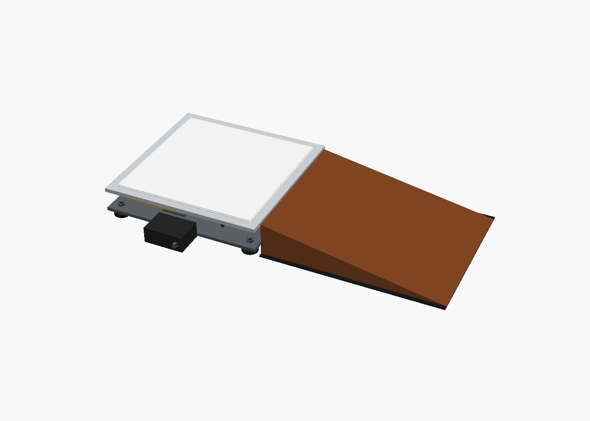

# corner-scales

DIY corner-weight scales for cars, built on an ESP32-S3 and the HX711 load cell amplifier. Each pad is a self-contained instrument; pads share readings over ESP-NOW, so connecting to any one of them (USB serial now, Bluetooth planned) gives all four corners. No network needed.

> **Status: prototype.** Phase 1 (bench pads rated ~200 kg) is in progress. Nothing here is rated for a car yet. See [docs/plan.md](docs/plan.md) for the roadmap.

> [!WARNING]
> **A car on scales can roll or slip off a pad or ramp.** Chock the wheels, keep people clear while rolling on and off, and never get under a car resting on scales. Build and use these at your own risk; see the license for the warranty disclaimer.



## What's here

| Path | Contents |
| --- | --- |
| [`firmware/`](firmware/) | Rust firmware (`esp-hal`, Embassy). `crates/` hold the hardware-independent logic with host tests; `pad/` is the ESP32-S3 binary. [Build and flash](firmware/README.md). |
| [`web/`](web/) | [Phone UI](web/README.md), served by the host pad over its own Wi-Fi. |
| [`tools/`](tools/) | [Plot page](tools/README.md) for captured test runs. |
| [`docs/`](docs/) | [Plan](docs/plan.md) · [Architecture](docs/ARCHITECTURE.md) · [Wiring](docs/wiring.md) · [Assembly](docs/assembly.md) · [Test protocol](docs/test-protocol.md) · [Parts](docs/bom.md) · [Scales protocol](docs/scales-protocol.md) |
| [`hardware/`](hardware/) | [Full-size pad](hardware/full-size-pad/README.md): draft OpenSCAD model, renders |

## Quick start

Run the host tests (needs only stable Rust):

```sh
cd firmware
cargo test
```

Building and flashing the pad firmware is described in [firmware/README.md](firmware/README.md).

## License

- Code (`firmware/`, `web/`, `tools/`): [Apache-2.0](LICENSE)
- Documentation (`docs/`, READMEs): [CC-BY-SA-4.0](LICENSE-docs)
- Hardware designs (`hardware/`): [CERN-OHL-P-2.0](hardware/LICENSE)

Contributions are welcome; see [CONTRIBUTING.md](CONTRIBUTING.md) and the [Code of Conduct](CODE_OF_CONDUCT.md).
