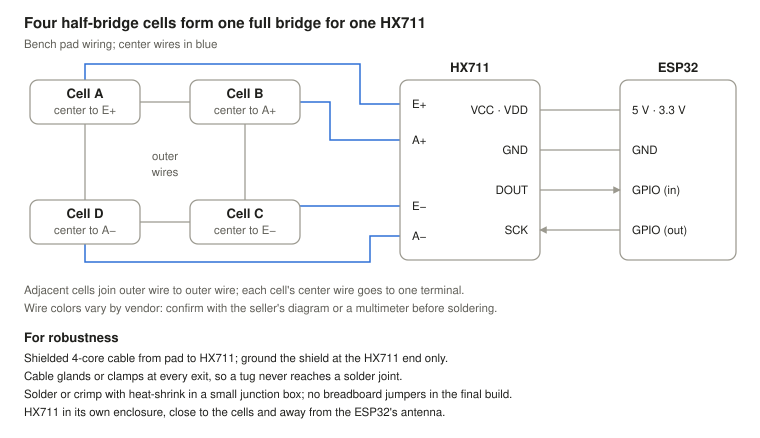

# DIY Corner Scales: Plan

Oct 6, 2026 · @jaimebuildsthings · Status: phase 1

**Contents:** [Goal](#goal-and-approach) · [Phase 1](#phase-1-bench-prototype) · [Firmware](#firmware-and-software) · [Tests](#test-protocol-and-pass-criteria) · [Phase 2](#phase-2-full-size-single-pad) · [Phase 3](#phase-3-four-pad-set) · [Risks](#risks-and-next-steps)

## Goal and approach

Start with one bench-top pad rated about 200 kg, built for roughly $115–200, and prove it is repeatable and linear before spending money on car-rated hardware. The electronics, firmware and calibration method carry straight over to the full-size build; only the mechanics and load cells change.

The work runs in three phases, each with a gate you pass before moving on:

1. **Bench prototype (this doc's focus),** in two steps:
   - **1a, one pad:** four 50 kg cells, an HX711 and an ESP32, read over USB serial. Learn wiring, filtering, tare and calibration with gym weights, and run the test protocol from a laptop. One or two weekends.
   - **1b, two pads:** a second identical pad with its own ESP32, linked over ESP-NOW. Pad A also runs the phone UI. Validates the multi-pad architecture and the weight-distribution math at bench scale.
2. **Full-size single pad:** one pad rated about 2,000 kg with car-grade cells, ramps and a slip plate. Learn what real loads do to the mechanics.
3. **Four-pad set:** three more identical pads, leveling, and the corner-weight app (total, front/rear, left/right, cross weight).

Firmware is written for four channels from day one, so phase 3 is a hardware job, not a rewrite. Prices in this plan are approximate, from memory, not looked up.

## Phase 1: bench prototype

A 300 × 300 mm top plate sits on four 50 kg half-bridge load cells, one per corner, wired as a single full bridge into one HX711. This copies the topology of a real scale pad (a plate on four supports) at one-tenth the load, so the lessons about load path and off-center loading transfer.

**Mechanical design**

- Top plate: 12 mm birch plywood or 6 mm aluminum. It must be stiff enough not to flex onto the base.
- Base plate: same size, gives the cells a flat, rigid floor.
- Cell mounts: printed or turned cups so each cell's center button carries the load and its outer frame flexes freely. Nothing else may touch the top plate.
- Leave a 3–5 mm gap around the top plate's edge so it can never rest on anything.

For robustness, set the overload stops so the plate lands on them before any cell passes its rating. Bolt the cups to the base, use threadlocker on every fastener, and keep the 3–5 mm edge gap all the way round.

**Wiring**

- Four half-bridge cells combine into one full bridge (the standard "bathroom scale" wiring: pair the cells diagonally, red wires to E+/E−/A+/A−).
- HX711 channel A, gain 128. On the SparkFun board, VCC feeds the analog side and VDD sets the logic level: VCC to 5 V (USB rail) for regulated ~4.3 V excitation, VDD to the ESP32's 3.3 V so logic levels match. Confirm against SparkFun's hookup guide before powering up.
- ESP32-S3 N16R8 pins: avoid GPIO 35–37 (octal PSRAM) and the strapping pins 0, 3, 45, 46.
- The pad-to-electronics link is shielded Cat6 with RJ45 jacks: excitation and signal each on their own twisted pair, shield grounded at the HX711 end only. Label the jacks "NOT ETHERNET": a PoE switch can put up to ~57 V on the bridge.
- Tie the HX711 RATE pin low for 10 samples/s (quieter) while learning; try 80 samples/s later.
- Keep cell leads short and twisted, one ground point, and the board away from the ESP32's Wi-Fi antenna.

**Parts list (approximate)**

Tick each item off as it arrives. Total is roughly $115–200, excluding tools (soldering iron, multimeter, drill, calipers).

*Electronics*

- [ ] DIYmalls 8× 50 kg half-bridge cells with brackets + 2× HX711, 1 kit, $15–25. Four cells for the pad, four spares; generic HX711s are spares.
- [ ] SparkFun Load Sensor Combinator (BOB-13878), 1, \~$7. Bridge wiring on a PCB; lines up with the SparkFun HX711.
- [ ] SparkFun Load Cell Amplifier HX711, 1, \~$11. Main amplifier.
- [ ] ESP32-S3-DevKitC-1 (N8R8 or N16R8), 2, $24–40 total. One for the pad, one as the hub for ESP-NOW testing (and a spare).
- [ ] DS18B20 waterproof probes, DROK 5-pack, $9.99. One for the prototype, the rest for the four pads later.
- [ ] Shielded Cat6 cable (1–2 m) + 2 RJ45 jacks, 1 set, $10–15. Pad to HX711.
- [ ] ABS project box, \~100 × 70 × 40 mm, + PG7 cable glands, 2, $10–15. One for the pad electronics, one for the hub.
- [ ] Hookup wire, heat-shrink, perfboard, screw terminals, \~$10.
- [ ] USB power bank or 5 V USB supply, 2, $0–30. One each for the pad and the hub.

*Mechanical*

- [ ] 12 mm Baltic birch, 300 × 300 mm, 2, $15–25. Top and base plates.
- [ ] M6 bolts, nuts, threaded inserts, 4 sets, $5–10. Adjustable overload stops.
- [ ] Dowel pin or shoulder bolt, 1, \~$2. Locating pin.
- [ ] Rubber feet, 4, \~$5.
- [ ] Wood screws, epoxy or VHB tape, blue threadlocker, \~$15. Bracket mounting depends on whether the holders have screw holes.

*Testing*

- [ ] Reference weights, $0–40. Gym plates or dumbbells, each verified on a known scale.

*Phase 1b additions (second pad)*

The kit's eight cells all go into the two pads, so a second kit is the spare stock.

- [ ] Second 8× 50 kg cell kit, 1, $15–25. Spares for both pads.
- [ ] SparkFun Load Sensor Combinator + SparkFun HX711, 1 each, \~$18. Matches pad A, so the two pads differ only in their cells.
- [ ] 12 mm Baltic birch, 300 × 300 mm, 2, $15–25. Pad B top and base.
- [ ] Shielded Cat6 cable + 2 RJ45 jacks, 1 set, $10–15.
- [ ] M6 stop hardware, locating pin, rubber feet, as for pad A, \~$15.
- [ ] A stiff plank, about 1 m, for the lever-rule test.

## Firmware and software

Build on ESP-IDF (v5.x) directly, as a CMake project split into components. ESP-IDF is Apache-2.0, so distributing firmware binaries stays simple: no LGPL obligations from the Arduino core and no copyleft libraries pulled in by accident. The HX711 driver is small enough to write ourselves, which also gives full control over its timing. Structure it as a pipeline from raw counts to kilograms, with every reading loggable as CSV for testing.

1. **`hx711` component:** GPIO bit-bang driver. Wait for DOUT to go low (data ready), then clock out 24 bits inside a short critical section so no pulse stays high past \~60 µs (longer powers the chip down). Model channels as an array of four from day one.
2. **Sampling task:** pinned to core 1 at high priority, pushing raw counts into a FreeRTOS queue. Wi-Fi and the web server stay on core 0, so radio interrupts don't corrupt reads.
3. **`scale` component:** filtering (median of 5, then a moving or exponential average), stability flag, tare and calibration as plain C with no IDF calls, so it can be unit-tested on the host (Unity, or the IDF Linux target).
4. **Calibration storage:** multi-point linear fit (counts → kg) saved in a dedicated NVS partition, so firmware updates never wipe a pad's calibration. Keep the residuals to show nonlinearity.
5. **Phone UI (no screen on the scale, phase 1b):** one pad (pad A) also runs its own Wi-Fi access point, so it works in any garage without home Wi-Fi; there is no dedicated hub board. Start with the fixed address `192.168.4.1`; a captive portal and an mDNS name (`scales.local`) come later as conveniences, since both behave inconsistently across phones. `esp_http_server` serves the page, embedded in the image with `EMBED_FILES`, and pushes live values over WebSocket. Buttons for tare, calibrate and "log CSV"; the CSV downloads straight to the phone. Later, optionally join home Wi-Fi through ESP-IDF's provisioning component and fall back to the access point.
6. **Logging:** a host-side Python script that reads USB serial (phase 1a) or the WebSocket (1b+), writes CSV and plots noise, drift and the calibration fit. Phase 1a needs only a serial console: tare, add a calibration point, fit, stream CSV.
7. **Pad comms (phase 1b):** ESP-NOW from each pad to the pad that hosts the UI, all on the access point's fixed channel. Every board runs the same firmware and `scale` component. Each pad stores its own calibration and sends kg, raw counts, a stable flag and temperature, so pads are self-contained instruments.

**Built to distribute**

- **License:** Apache-2.0 for code (matches ESP-IDF), CC-BY-SA-4.0 for docs, CERN-OHL-P-2.0 for hardware designs. Check the license of any component before adding it.
- **Builds:** GitHub Actions with Espressif's `esp-idf-ci-action`, pinned to one IDF version, producing tagged, versioned binaries.
- **Install:** a browser flasher (ESP Web Tools) so other builders can flash a board without installing IDF.
- **Updates:** the partition table has two OTA app slots from day one (changing it later needs a USB reflash). OTA itself comes later, with rollback; a browser upload to the UI pad suits a garage with no internet better than `esp_https_ota`. Phase 1 flashes over USB.
- **Hardening:** secure boot and flash encryption only if you later sell finished hardware; they complicate hobbyist reflashing.

Add the corner math (total, percentages, cross weight) in phase 3; the data model already supports it.

## Test protocol and pass criteria

The prototype passes when it repeats within about 0.1% of full scale and stays linear within 0.25%. For corner balancing, repeatability matters more than absolute accuracy. Targets below assume a 200 kg full scale; they are starting points to tighten or loosen once you see real data.

| Test | How | Pass target |
| --- | --- | --- |
| Zero noise | 100 readings unloaded; take the standard deviation | ≤ 50 g |
| Repeatability | Place and remove the same \~20 kg weight 10 times | Spread ≤ 200 g (0.1% FS) |
| Linearity | Load 0 → max in 5+ steps with known weights; fit a line | Max residual ≤ 500 g (0.25% FS) |
| Off-center load | Same weight at center and each corner of the plate | Readings within 0.5% of each other |
| Creep | Hold a heavy load 10 min, log every second | Drift ≤ 200 g |
| Return to zero | Unload after the creep test | Back within 50 g of zero |
| Temperature | Re-run zero and one weight cold vs. warm garage | Record the drift; define a re-tare rule |

If off-center readings disagree, the problem is mechanical (mounts binding, plate flexing or touching) and must be fixed before phase 2, because a tire never lands dead center on a pad.

**Phase 1b: two-pad distribution test**

Each pad first passes the single-pad tests above. Then lay a stiff plank across both pads (supports a span L apart), tare with the plank on, and move a known weight W along it in 5–7 steps. With the weight a distance x from pad A's support, the lever rule predicts pad A reads W·(L−x)/L and pad B reads W·x/L.

| Test | How | Pass target |
| --- | --- | --- |
| Split | Measured share on pad B vs. predicted x/L at each position | Within 0.2 percentage points |
| Sum | A + B at each position vs. W weighed on a single pad | Within the repeatability spread (200 g) |
| Link | Stream both pads for 10 min over ESP-NOW | No gaps longer than 1 s |

Two supports are statically determinate, so a level difference between the pads barely moves the split. Leveling sensitivity only appears with four supports and is tested in phase 3.

## Phase 2: full-size single pad

Scale the same design up: one pad rated about 2,000 kg, which gives roughly 2× headroom over a \~900 kg corner of a car like the Supra.

- **Cells:** four full-bridge shear-beam cells around 500 kg each, summed through a 4-way junction box into one HX711. The firmware stays the same.
- **Pad:** about 400 × 400 mm, 10 mm aluminum or a ribbed steel top that won't flex under a tire contact patch.
- **Ramps:** matched height so the car rolls on without impact loading the cells.
- **Slip plate:** two greased sheets (or a turntable) on top so the tire can scrub sideways as the suspension settles.
- **Calibration:** you can't easily stack 900 kg. Combine your body weight, plates and a few verified heavy items for points up to a few hundred kg, then check a full corner by weighing the car on a certified truck scale and comparing totals later in phase 3.
- **Gate:** roll the same corner on and off 10 times; readings should repeat within about 2–3 kg.

For robustness, size the stops so a car bouncing on the pad lands on them, not on the cells. Put the ramp on a rubber mat so it can't creep into the pad, and seal the electronics box against dust and water from a wet garage floor.

## Phase 3: four-pad set

Build three more identical pads, then add leveling and the corner app.

- **Comms:** one ESP32 per pad sending readings over ESP-NOW to the pad that hosts the phone UI, as proven in phase 1b. Fallback: wire four HX711s to one board; the firmware's four-channel model supports both.
- **Leveling:** measure the floor at each pad location and shim the pads level with each other. Floor error shifts cross weight more than sensor error does.
- **Procedure:** driver weight (or ballast) in the seat, fuel level noted, roll on, bounce the car, roll off and on again, then read.
- **Corner math:** total, front/rear %, left/right %, and cross weight:

**cross % = (LF + RR) / (LF + RF + LR + RR) × 100**

LF, RF, LR, RR are the left-front, right-front, left-rear and right-rear corner weights.

A 50% cross weight is the usual target for autocross and track setups, adjusted with spring perches or coilover collars.

## Risks and next steps

The biggest risk is mechanical, not electronic: a pad whose load leaks around the cells will read consistently and wrongly.

- **Load bypass:** any contact between top plate and frame. Check with the off-center test and a feeler gauge around the gap.
- **Cheap cells and HX711 boards:** inconsistent quality; buy spares and test each before installing.
- **Noise from Wi-Fi:** the ESP32 radio can couple into the HX711. Shield, separate, or sample with the radio idle.
- **Calibration weights:** an unverified dumbbell is a bad reference. Weigh each on a known-good scale first.
- **Safety (phase 2+):** a car slipping off a pad or ramp is the real hazard. Use wheel chocks and never get under a car resting on scales.

**First steps**

- [x] Order the phase 1a parts (cells, spare HX711s, ESP32s, temperature probes)
- [ ] Order the phase 1b additions (second cell kit, SparkFun HX711 + combinator, plates, cable)
- [ ] Cut plates and print the four cell mounts
- [ ] Wire the bridge, get raw counts on serial
- [ ] Add tare and two-point calibration; check with one known weight
- [ ] Build the CSV logger and run the test protocol
- [ ] Fix mechanical issues until off-center and repeatability pass
- [ ] Build pad B, link the pads over ESP-NOW, bring up the phone UI
- [ ] Run the two-pad distribution test
- [ ] Decide on phase 2 cell type and pad size
