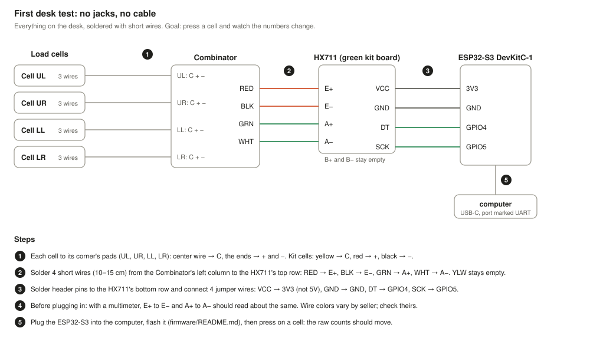
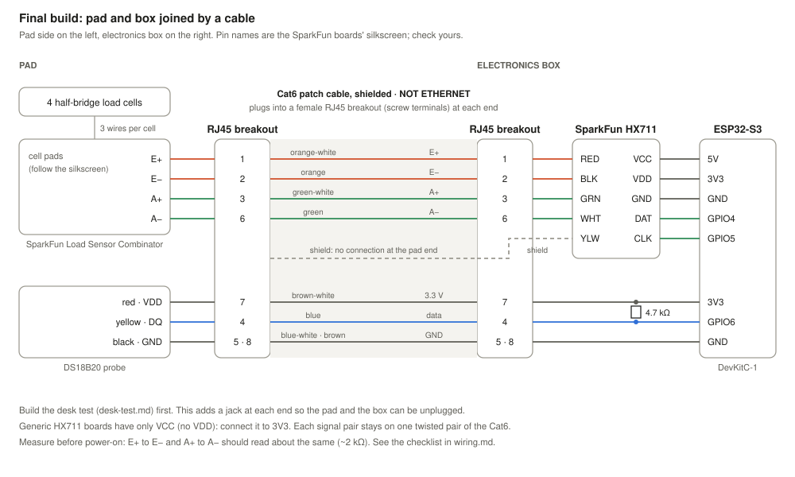

# Wiring

One pad: four half-bridge load cells → SparkFun Load Sensor Combinator → shielded Cat6 → SparkFun HX711 → ESP32-S3.

**Contents:** [Desk test](#first-desk-test) · [Final build](#final-build) · [Bridge](#load-cell-bridge) · [Pad cable](#pad-cable-rj45) · [HX711 to ESP32](#hx711-to-esp32) · [Temperature probe](#temperature-probe) · [Checks](#before-power-on)

> [!WARNING]
> The RJ45 jacks are **not Ethernet**. A PoE switch can put up to ~57 V on the bridge. Label both ends.

## First desk test

Start here: everything on the desk, no jacks or cable.

## Final build

The pad and the electronics box are separate, joined by a Cat6 patch cable. Each end has a female RJ45 breakout board with screw terminals.

## Load cell bridge

- Four half-bridge cells form one full bridge. Pair them diagonally; each cell's center (red) wire goes to one of E+, A+, E−, A−.
- The Combinator does this on a PCB. Follow its silkscreen.
- Wire colors vary by vendor. Confirm with the seller's diagram or a multimeter before soldering.

## Pad cable (RJ45)

Shielded Cat6, T568B colors. Each signal pair stays on one twisted pair.

| Pin | Color (T568B) | Signal | Pair |
| --- | --- | --- | --- |
| 1 | orange-white | E+ (excitation) | excitation |
| 2 | orange | E− | excitation |
| 3 | green-white | A+ (signal) | signal |
| 6 | green | A− | signal |
| 4 | blue | DS18B20 data | probe |
| 5 | blue-white | GND | probe |
| 7 | brown-white | 3.3 V (probe) | power |
| 8 | brown | GND | power |

Ground the cable shield **at the HX711 end only**.

## HX711 to ESP32

| HX711 (SparkFun) | ESP32-S3 | ESP32 (spare boards) |
| --- | --- | --- |
| VCC (analog, excitation) | 5V | 5V (VIN) |
| VDD (logic level) | 3V3 | 3V3 |
| GND | GND | GND |
| DAT / DOUT | GPIO4 | GPIO16 |
| CLK / SCK | GPIO5 | GPIO17 |

- **VCC to 5 V** gives regulated ~4.3 V excitation, so more signal and less noise than 3.3 V. **VDD to 3.3 V** keeps logic levels safe. Confirm against SparkFun's hookup guide.
- Channel A, gain 128. Leave RATE low (10 samples/s) while learning.
- Generic HX711 boards: some don't tie E− to ground. Check with a multimeter.

Pins to avoid on the ESP32-S3 N16R8: GPIO 26–37 (flash/PSRAM), strapping pins 0, 3, 45, 46, and 43/44 (console UART).

## Status LED

`blink` flashes the onboard LED: the RGB LED on GPIO48 on ESP32-S3 DevKitC boards (some board revisions use GPIO38; check the silkscreen), or the LED on GPIO2 on original ESP32 DevKits.

## Temperature probe

DS18B20 data to GPIO6 (ESP32-S3) or GPIO4 (ESP32), with a **4.7 kΩ pull-up to 3.3 V**. The firmware runs fine without it.

## Before power-on

- [ ] Bridge resistance: E+ to E− and A+ to A− roughly equal (typically ~1 kΩ for these cells)
- [ ] No short between any bridge wire and the shield
- [ ] Jacks labelled "NOT ETHERNET"
- [ ] Shields grounded at one end only
- [ ] Twisted leads kept short; HX711 away from the ESP32's antenna
