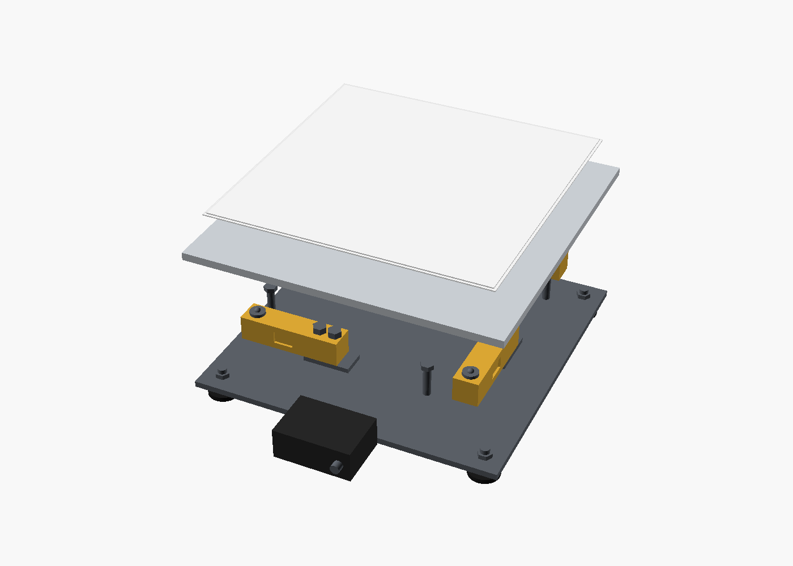

# Full-size pad (phase 2 draft)

One ~2,000 kg car pad from [docs/plan.md](../../docs/plan.md#phase-2-full-size-single-pad). It is a parametric [OpenSCAD](https://openscad.org) model, [`pad.scad`](pad.scad).

| Exploded | Side, with a 640 mm tire |
| --- | --- |
|  |  |

## Layout

| Part | What |
| --- | --- |
| Slip plate | Two greased 1.5 mm sheets, 360 mm square, so the tire can settle sideways |
| Top plate | 400 × 400 × 10 mm aluminum; must not flex |
| Load cells | Four ~500 kg shear beams in a pinwheel; fixed end bolted on a spacer block, ball button under the plate |
| Overload stops | Bolts 2 mm under the plate; a bouncing car lands on them, not the cells |
| Locating pin | Center, in an oversize hole; stops sliding, carries no load |
| Base | 8 mm steel on four M12 leveling feet with lock nuts |
| Electronics box | 100 × 70 × 40 mm, on the base, sealed, cable gland |
| Ramp | Separate, on a rubber mat, 6 mm from the pad; 450 mm long (about 11°) |

Deck height is 85 mm to the top of the slip plate.

## Changing the model

Open `pad.scad` in OpenSCAD and press **F5** to preview. `explode` lifts the parts apart; `show_tire` and `show_ramp` toggle the context parts. The render commands for `images/` are at the top of the file.

## Open questions

- **Cell dimensions** are typical, not from a datasheet. Update `cell_l`, `cell_w` and `cell_h` once cells are chosen.
- **Ramp slope.** 11° may scrape a low front splitter; a longer ramp (`len`) lowers it.
- **Base stiffness.** A plain 8 mm plate may flex between the feet; ribs or a tube frame may be needed.
